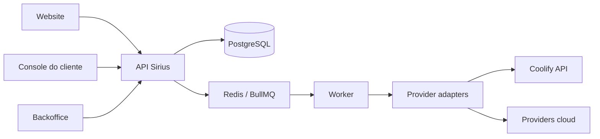

# Arquitectura Sirius Cloud

## Direcção proposta

A Sirius Cloud será um control plane multi-tenant baseado num monólito modular TypeScript. O website, console e backoffice comunicam com a API Sirius; um worker executa operações assíncronas via adaptadores de providers. PostgreSQL é a fonte de verdade comercial. Redis/BullMQ será introduzido quando existir provisionamento assíncrono.

## Fronteiras de confiança

- A API Sirius controla identidade, organizações, autorização, catálogo, facturação e estado comercial.
- Providers executam operações de infraestrutura, mas não decidem autorização ou titularidade comercial.
- Segredos administrativos dos providers ficam apenas no servidor/worker.
- O console nunca fala directamente com a API administrativa do Coolify.
- O estado actual em `/dashboard` é apenas demonstração local; não é persistido.

## Decisões pendentes

- Modularizar o monorepo com pnpm/Turborepo.
- Escolher estratégia de sessão e gestão de segredos após threat model.
- Verificar as capacidades e limites da API pública Coolify antes de definir o adaptador.
- Confirmar requisitos legais/fiscais e gateway de pagamentos aplicável em Angola.
